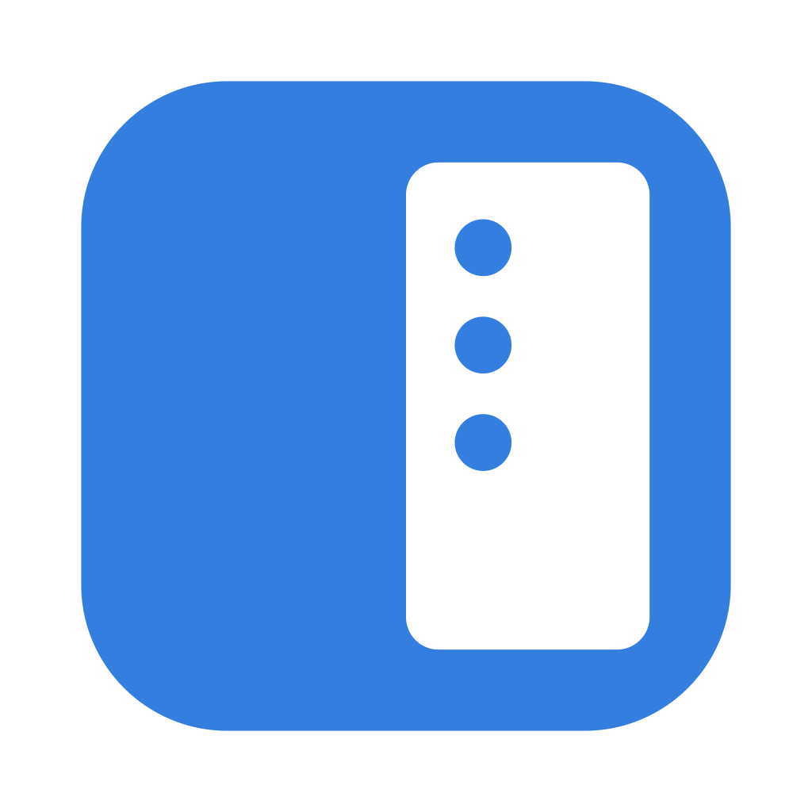

<p align="center">
  
</p>

<h1 align="center">Slotbar</h1>

<p align="center">
  Gmail, Google Calendar, Google Chat and any other web app in a Panel that slides in from the edge of your Mac's screen.
</p>

<p align="center">
  <a href="https://github.com/mogui/slotbar/releases/latest"></a>
  
  
</p>

---

## Features

- **One hotkey, every web app**: `Ctrl+Option+S` (or a click on the menu bar icon) slides the Panel in from the right, left, top or bottom edge, on any Space and over full-screen apps.
- **Slots**: each web app is a Slot, a starting URL plus a Profile. `Cmd+1` ... `Cmd+9` switch between them.
- **Profiles**: one Profile per Google account, each with its own isolated session. All Slots of a Profile share it, so you sign in once per account. A colored bar next to each Slot icon shows its Profile.
- **Native notifications**: web notifications become macOS notifications. Clicking a Google Chat notification opens that conversation.
- **Unread badges**: Gmail's Inbox count, Chat's unread dot and any `(N)` page title show on the Slot icon and in the menu bar.
- **Light on memory**: Slots without Keep-alive unload 5 minutes after you last looked at them.
- **Links where they belong**: links to another Slot of the same Profile open there; everything else opens in your default browser.
- **Optional Dock icon**: turn on Show in Dock to reach Slotbar with `Cmd+Tab`.

## Install

1. Download `Slotbar-X.Y.Z.dmg` from the [latest release](https://github.com/mogui/slotbar/releases/latest).
2. Optional: check the SHA-256 against the one in the release notes.
   ```sh
   shasum -a 256 ~/Downloads/Slotbar-X.Y.Z.dmg
   ```
3. Open the DMG and drag **Slotbar** onto **Applications**.
4. Slotbar is not notarized by Apple, so macOS blocks it on first launch. Remove the quarantine flag, then open it:
   ```sh
   xattr -dr com.apple.quarantine /Applications/Slotbar.app
   open /Applications/Slotbar.app
   ```
   Alternative: open the app once, then go to System Settings > Privacy & Security and click "Open Anyway". On macOS 15 and later, Control-click > Open does not bypass the warning.

Slotbar must live in `/Applications` or `~/Applications`: notifications do not work from anywhere else. Until it is there, Slotbar shows a "Move Slotbar to Applications" alert at every launch.

Requires macOS 14 Sonoma or later, Apple silicon or Intel.

## First run

Slotbar starts with a preset in a Profile named "Default":

| Slot | URL | Keep-alive |
|---|---|---|
| 1 | `https://mail.google.com/` | on |
| 2 | `https://calendar.google.com/` | off |
| 3 | `https://chat.google.com/` | on |

1. Allow notifications when macOS asks.
2. Open the Panel with `Ctrl+Option+S` or the menu bar icon.
3. Sign in inside the Gmail Slot. Calendar and Chat use the same session.

Tip: with a Chat Slot, turn off Chat in Gmail (Gmail Settings > Chat and Meet > Chat: Off) so Chat is not loaded twice.

## Signing in

- Sign in with password + 2FA.
- On a passkey or security-key prompt, choose "Try another way".
- Accounts with Advanced Protection and Workspace accounts that enforce security keys cannot be used as Profiles.

Slotbar presents a desktop Firefox user agent to Google. To override it, run the following, then quit and relaunch Slotbar:

```sh
defaults write io.github.mogui.slotbar UserAgent "<string>"
```

To go back to the built-in user agent:

```sh
defaults delete io.github.mogui.slotbar UserAgent
```

## Usage

### Rail

The Rail is the strip on the Panel's outer side: one icon per Slot (favicon, Profile color bar, unread badge), then a gear that opens Settings. Click an icon to switch to that Slot; hover for its label and shortcut.

Right-click a Slot icon for:

- Go home
- Open current page in browser
- Reload
- Notifications (on/off for that Slot)

### Shortcuts

| Keys | Action |
|---|---|
| `Ctrl+Option+S` | Show / hide the Panel (global; change it in Settings) |
| `Cmd+1` ... `Cmd+9` | Switch to Slot N |
| `Cmd+Shift+H` | Go home (active Slot) |
| `Cmd+Shift+O` | Open current page in browser (active Slot) |
| `Cmd+R` | Reload (active Slot) |
| `Cmd+W` | Hide the Panel; in a popup window, close that window |
| `Cmd+,` | Settings |
| `Cmd+Q` | Quit Slotbar |

Esc is left to the page. If the global hotkey cannot be registered (for example because macOS already uses it), Settings shows a warning and the menu bar icon's right-click menu shows "Hotkey unavailable"; clicking the icon still works.

### Settings

Settings opens inside the Panel (gear, `Cmd+,` or the menu bar icon's right-click menu). Click a Slot icon to go back.

- **General**: global hotkey, Panel edge, Hide when Slotbar loses focus, Show in Dock, Open at login.
- **Profiles**: add, rename, recolor or delete Profiles. Deleting a Profile deletes its Slots and its session.
- **Slots**: add Slots with "+"; edit label, URL and Profile inline; use the "..." menu to move or delete a Slot. Per Slot:
  - **Keep-alive**: the Slot loads at launch and stays loaded. Without it, the Slot loads on first open and unloads 5 minutes after it was last shown (sooner under memory pressure).
  - **Notifications**: whether the Slot can post macOS notifications.

## Upgrade

1. Quit Slotbar (menu bar icon right-click > Quit Slotbar).
2. Open the new DMG and drag Slotbar onto Applications, replacing the old copy.
3. Remove the quarantine flag again and open it:
   ```sh
   xattr -dr com.apple.quarantine /Applications/Slotbar.app
   open /Applications/Slotbar.app
   ```

Settings and sessions are kept. With Open at login on, macOS may show a "Login item added" banner after each upgrade.

## Build from source

Requires Xcode with Swift 6.

```sh
scripts/build-app.sh release   # universal arm64 + x86_64, ad-hoc signed
swift test                     # unit tests
```

The app is written to `build/Slotbar.app`. `scripts/build-app.sh debug` builds a debug app with the Web Inspector enabled.

### Releasing

Push a `vX.Y.Z` tag. The [Release workflow](.github/workflows/release.yml) runs `scripts/release.sh`, which builds the universal app, packages `Slotbar-X.Y.Z.dmg` and publishes it as a GitHub Release with its SHA-256.

```sh
git tag v0.2.0 && git push origin v0.2.0
```

`PUBLISH=0 scripts/release.sh v0.2.0` builds the DMG locally without publishing.

## Limitations

- The app is ad-hoc signed and not notarized, so every download needs the quarantine step above.
- No passkeys or security keys.
- Notifications and unread badges come only from loaded Slots.
- Opening a Chat conversation from a notification reloads the Chat Slot.
- Calls and huddles (Meet, Chat): use the browser.
- Google may block sign-in inside embedded web views at any time.
